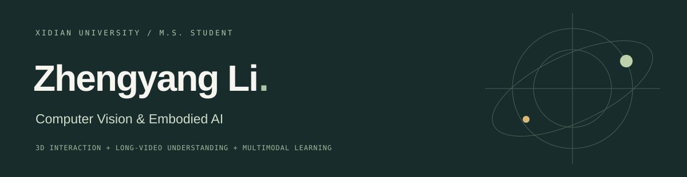

  

## Hi, I'm Zhengyang Li / 李正阳

**M.S. student in Computer Science and Technology at Xidian University.**

I work on **3D human-object-scene interaction**, **long-video understanding**, and **multimodal learning**. My current research explores scene-state updates, contact constraints, and collision avoidance for sequential object manipulation.

西安电子科技大学计算机科学与技术硕士在读。本科毕业于山西大学软件工程专业，排名前 1%，推免读研。关注文本驱动的三维交互生成，以及视觉与多模态推理。

[Personal Website / 个人主页 ↗](https://xiaoxiaoyang1222.github.io/) · [Résumé / 简历 ↗](https://xiaoxiaoyang1222.github.io/cv.html) · [Email ↗](mailto:li_zhengyang1222@163.com)

 

### Selected work

| Project | Focus | Result / Status |
| :--- | :--- | :--- |
| [Sequential 3D interaction](https://github.com/xiaoxiaoyang1222/hosig-experiments) | Scene-state updates, contact & collision constraints; experiments based on the HOSIG baseline | Ongoing research |
| CASTLE Challenge @ EgoVis · CVPR 2026 | Multiview long-video QA with evidence retrieval & Qwen reasoning | 🥇 1st place · Team lead |
| Hoi! Force Prediction · ECCV 2026 | Egocentric force & work prediction with DINOv2 and regression | 🥈 2nd place · Team member |
| LoViF 4D World Model · CVPR 2026 | Video quality assessment & physical anomaly localization | 🥉 3rd place · Team lead |

### More challenge results

- **SLoMO · Movie QA, Special Track · ECCV 2026:** 1st place, team member.
- **doScenes · Language and History Track · CVPR 2026:** 1st prize, team member.
- **ReLearn · Multimodal Theory of Mind, Track 1 · CVPR 2026:** 2nd place, team member.

### Education & tools

**Xidian University** · M.S. in Computer Science and Technology · 2025–2028 (expected)  
**Shanxi University** · B.S. in Software Engineering · 2021–2025 · Rank 8/800

`Python` · `PyTorch` · `Qwen / VLMs` · `DINOv2` · `InternVideo2` · `CLIP`

Open to conversations about visual perception, multimodal reasoning, and 3D interaction.
